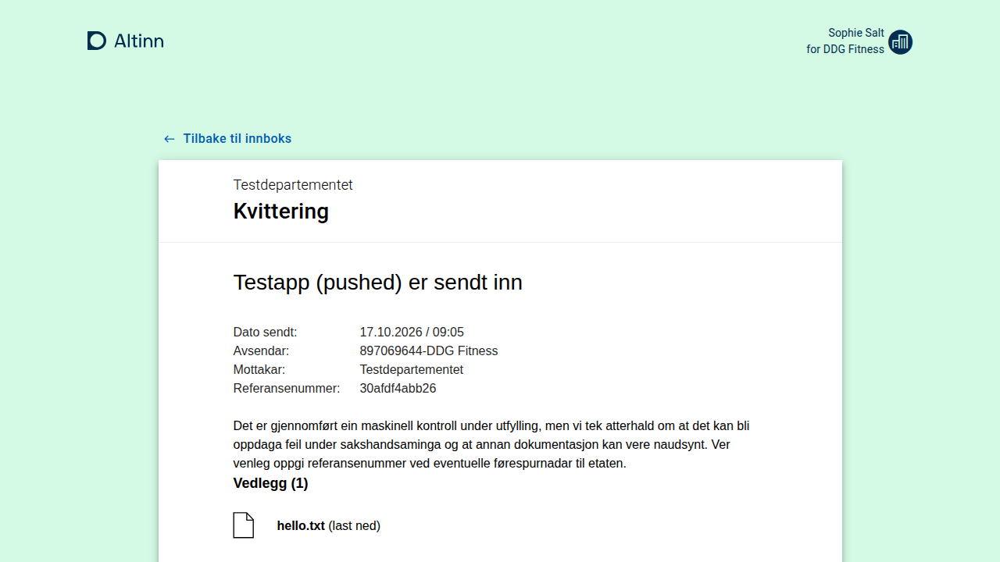

# Receipt for the new localtest stack

Research date: 2026-10-20 (task 16 of [`../../TODO.md`](../../TODO.md)), written against this repository at `178f3da`.
Read-only plus scratch builds and one scratch start of the host, listed in section 5.3; nothing was built as an image,
no container or studioctl command was touched, and the running stack only received GETs. Claims read from code and
not observed are marked "not verified".

## Summary

- **The receipt app is small and needs nothing the stack lacks.** One ASP.NET host (about 1 500 lines of C#) serving
  one Razor page, a React bundle and five JSON endpoints under `/receipt/`. It has no database, no queue and no blob
  store. It calls Storage, Register and Profile with the user's `AltinnStudioRuntime` token, adds a platform access
  token (`platform`/`receipt`) for Register and Profile, and signs users in through Authentication's
  `authentication?goto=`. The browser also reads Storage's application metadata and texts and altinncdn.no's org list.
  Every one of these is already in the default stack.
- **Verified end to end in a scratch run.** Built under the vendoring model's props/targets with `LOCALTEST` defined,
  two directive sites and a 40-line fake, published, started on port 5060 against the running stack, and opened in
  Chromium through a scratch path-split proxy: the receipt for the archived `ttd/testapp` instance `500000/e8c9134b…`
  rendered for user 1337 with the party, the user, the app's title, the sender and receiver table and a working
  attachment link ([screenshot](scratch-receipt-1337.png), section 5.3). Forbidden user: 403; unknown instance: 404; no cookie: redirect to
  Authentication, which sends the user back to `/receipt/…` after sign-in.
- **Two things are hard-wired to production hosts**, and both have a small fix:
  1. The 401 redirect builds its `goto` as `https://platform.{Hostname}{path}`
     ([`Program.cs:256`](https://github.com/Altinn/altinn-receipt/blob/babc0ed23483e8c3fb62dad4da903c6a88024914/src/backend/Altinn.Receipt/Program.cs#L256)).
     Locally there is no `platform.` host and no TLS. Fix: one `#if !LOCALTEST` site that uses the request's own
     origin.
  2. Attachment and PDF links come from Storage's `selfLinks.platform`, which says
     `https://platform.local.altinn.cloud/storage/…` (the Storage component keeps the production format). That host
     does not resolve here. The frontend only makes same-host links relative, so the links are dead. Fix: a fake
     `IStorage` decorator that rewrites the prefix to the public origin. It is DI-only, so no directive is needed
     beyond the one hook.
- **Nothing in the stack links to `/receipt/` yet, so the 404 costs testers nothing today.** The only producer is the
  Dialogporten adapter's go-to action for archived instances (task 10, unapproved), and the only place a person
  clicks it is Arbeidsflate (task 11). The app frontend (monorepo and `app-frontend-react`), app-lib (v8 and the
  monorepo) and the old localtest never link to it; apps show their own receipt page at process end.
- **Correction to task 10.** The adapter's transmission receipt
  (`storage/dialogporten/api/v1/receipt/{dialogId}/{transmissionId}`) does not call the receipt app. It composes
  Markdown from Dialogporten, Storage, Register and the CDN
  ([`InstanceReceipt.cs`](https://github.com/Altinn/altinn-dialogporten-adapter/blob/0a329856ba79101acdf54c29fd84a5063189a42d/src/Altinn.DialogportenAdapter.WebApi/Features/Command/Sync/InstanceReceipt.cs#L56-L115)).
  Task 10's smoke step expects "a 404 from the missing receipt app" there. It should expect 200 with Markdown, or
  404 only for a missing dialog, instance, application or transmission.
- **Recommendation: Option A, vendor it into the default stack.** It needs two directive sites in `Program.cs`, one
  fake (the `selfLinks` decorator and the hook), configuration by environment only, a three-stage Dockerfile that
  mirrors upstream (Node build of the React bundle, .NET 10 SDK publish, chiseled runtime), host port 8034 and proxy
  prefix `/receipt`. No provisioning is needed. The host uses about 67 MB RSS idle. Effort: **2 to 3 days**.

## 1. Pins

| Repository | Commit | Date | Use |
| --- | --- | --- | --- |
| `Altinn/altinn-receipt` | [`babc0ed`](https://github.com/Altinn/altinn-receipt/commit/babc0ed23483e8c3fb62dad4da903c6a88024914) (`babc0ed23483e8c3fb62dad4da903c6a88024914`) | 2026-10-20 | the pin (default branch `main`). Backend last changed in `9fb9fa2` (2026-10-16, NuGet bumps); the .NET 10 and chiseled-image move is `28840d2` (2026-10-13). Renovate commits land almost daily, mostly frontend dependencies |
| `Altinn/altinn-dialogporten-adapter` | `0a32985` | 2026-10-08 | the adapter's pin in `../dialogporten/dialogporten-adapter.md` |
| `Altinn/altinn-studio` | `9493f65` | 2026-10-20 | app frontend (`src/App/frontend`), app-lib v9 (`src/App/backend`), old localtest (`src/Runtime/localtest`) |
| `Altinn/app-frontend-react` | `acb618f` | 2026-10-20 | app frontend v4 |
| `Altinn/app-lib-dotnet` | `f708593` | 2026-10-20 | app-lib v8 |
| `Altinn/app-localtest` | `998561e` | 2026-10-02 | the legacy localtest repository |

## 2. What the receipt app is

### 2.1 Shape

| Part | What |
| --- | --- |
| `src/backend/Altinn.Receipt/` | `Altinn.Platform.Receipt.csproj`, `Microsoft.NET.Sdk.Web`, `net10.0`, top-level `Program.cs`, MVC with one Razor view (`Views/Receipt/receipt.cshtml`), `GenerateDocumentationFile` on. Plain `PackageReference` versions: no central package management, no `global.json`, no analyzers beyond the SDK's. The root `Directory.Build.props` only adds `CSharpier.MsBuild` |
| `src/frontend/` | React 18 with Material UI 4 and axios, TypeScript 4.9, webpack 5, Yarn 3.8.7 (committed `.yarn/releases`, `nodeLinker: node-modules`). `yarn build` emits `dist/receipt.js` (3.1 MB) and `dist/receipt.css` |
| `test/` | xUnit tests for the backend (not run here) |
| `Dockerfile` | three stages: `node:24.21-alpine3.24` builds the bundle, `dotnet/sdk:10.0-resolute` publishes the host, `dotnet/aspnet:10.0-resolute-chiseled` runs it as `$APP_UID` on port 5060, with the bundle copied to `wwwroot/receipt/js/react/receipt.js` and `wwwroot/receipt/css/receipt.css` |
| `.deploy/app.yaml` | a Flux `HelmRelease` of the `altinn-receipt` chart from altinn-studio-ops. The chart's values, including how the signing certificate is mounted, are not public (not verified) |

### 2.2 Routes (all on the platform host, `platform.{env}.altinn.no` in production)

| Route | Auth | What |
| --- | --- | --- |
| `GET receipt/{instanceOwnerId}/{instanceId}?returnUrl=` | cookie | the Razor page that loads the bundle. The ids are bound but not used server-side; the bundle reads them from `location.pathname` |
| `GET receipt/api/v1/users/current` | cookie | Profile `users/{userId}` for the `urn:altinn:userid` claim |
| `GET receipt/api/v1/users/current/language` | cookie | the language from the Altinn 2 cookie `altinnPersistentContext` (`UL=1033/1044/2068`), else 204 |
| `GET receipt/api/v1/instances/{instanceOwnerId}/{instanceGuid}?includeParty=true` | cookie | Storage `instances/{owner}/{guid}`, plus Register `parties/{partyId}` for the owner |
| `GET receipt/api/v1/application/attachmentgroupstohide` | cookie | the configured `GeneralSettings:AttachmentGroupsToHide` (the adapter copies the same list into `ReceiptAttachmentVisibilityDecider`) |
| `receipt/api/v1/error` | anonymous | ProblemDetails for unhandled exceptions outside Development |
| `GET receipt/js/react/receipt.js`, `receipt/css/receipt.css` | anonymous | static files from `wwwroot` |
| `GET /health` | anonymous | `Healthy`, at the root and not under `/receipt` |

The controller is `[Authorize]` with the `JwtCookie` scheme only
([`ReceiptController.cs`](https://github.com/Altinn/altinn-receipt/blob/babc0ed23483e8c3fb62dad4da903c6a88024914/src/backend/Altinn.Receipt/Controllers/ReceiptController.cs#L69-L184)).
There is no PDP call of its own; access is whatever Storage and Register decide for the user's token.

### 2.3 Authentication

- `AddJwtCookie` reads cookie `GeneralSettings:RuntimeCookieName` (`AltinnStudioRuntime`) and validates its signature
  against `GeneralSettings:OpenIdWellKnownEndpoint` (Authentication's OpenID metadata). Issuer and audience are not
  checked, lifetime is, and clock skew is zero. HTTP metadata is allowed only in `Development`
  ([`Program.cs:193-213`](https://github.com/Altinn/altinn-receipt/blob/babc0ed23483e8c3fb62dad4da903c6a88024914/src/backend/Altinn.Receipt/Program.cs#L193-L213)).
- A 401 becomes `302 {PlatformSettings:ApiAuthenticationEndpoint}authentication?goto={https://platform.{GeneralSettings:Hostname}{path}{query}}`
  in `UseStatusCodePages`
  ([`Program.cs:252-266`](https://github.com/Altinn/altinn-receipt/blob/babc0ed23483e8c3fb62dad4da903c6a88024914/src/backend/Altinn.Receipt/Program.cs#L252-L266)).
  The endpoint is read from the `PlatformSettings__ApiAuthenticationEndpoint` environment variable first. The browser
  follows this redirect, so the endpoint must be the public origin.
- The receipt calls no Authentication API (no refresh and no exchange). Authentication is only the sign-in target and
  the JWKS source.

### 2.4 What it calls, and with which credential

| Caller | Call | Credential | Code |
| --- | --- | --- | --- |
| backend | Storage `GET instances/{owner}/{guid}` | `Authorization: Bearer {AltinnStudioRuntime}` | `StorageWrapper` |
| backend | Register `GET parties/{partyId}` | bearer user token and `PlatformAccessToken` from `GenerateAccessToken("platform", "receipt")` | `RegisterWrapper` |
| backend | Profile `GET users/{userId}` | bearer user token and the same platform access token | `ProfileWrapper` |
| browser | `GET {origin}/storage/api/v1/applications/{org}/{app}` | none (anonymous in Storage) | `receiptUrlHelper.ts` |
| browser | `GET {origin}/storage/api/v1/applications/{org}/{app}/texts/{lang}`, trying the user's language, then the others | the `AltinnStudioRuntime` cookie (Storage `[Authorize]`) | `hooks.ts` |
| browser | `GET https://altinncdn.no/orgs/altinn-orgs.json` | none | `receiptUrlHelper.ts` |
| browser | fonts and icons from Google Fonts, `use.fontawesome.com`, `use.fortawesome.com`; logo from altinncdn.no | none | `receipt.cshtml`, `AltinnLogo.tsx` |
| browser (links) | attachments and the PDF: `selfLinks.platform` of each data element | the cookie | `attachmentsUtils.ts` |

Every backend client also sends `Ocp-Apim-Subscription-Key` with the configured `SubscriptionKey` ("Will be inserted
during deploy"). Nothing local checks it.

The platform access token is signed by `Altinn.Common.AccessTokenClient` 3.2.12's `SigningCredentialsResolver`. The
receipt never binds `AccessTokenSettings`, so the resolver reads its default path, `{parent of the working
directory}/accesstoken/accesstokencredentials.pfx`. In the image the working directory is `/app`, so the path is
`/accesstoken/accesstokencredentials.pfx` (read in the decompiled package). This is exactly the Events and
Notifications case: studioctl bind-mounts the shared certificate there. The certificate is password-less, which
the resolver's `new X509Certificate2(fileName)` needs. If the file is missing, `GenerateAccessToken` logs a warning
and returns null, and Register and Profile then answer 401 or 403.

### 2.5 The frontend's own environment logic

- `getAltinnCloudUrl()` points at `https://platform.at22.altinn.cloud/` when the hostname is `localhost`,
  `127.0.0.1` or `altinn3.no`, and at `window.location.origin` otherwise
  ([`receiptUrlHelper.ts:12-24`](https://github.com/Altinn/altinn-receipt/blob/babc0ed23483e8c3fb62dad4da903c6a88024914/src/frontend/src/utils/receiptUrlHelper.ts#L12-L24)).
  **The receipt must be opened on `local.altinn.cloud`, never on `localhost:<port>`.** On `localhost` it would read
  at22.
- `urlHelper.ts` already knows `local.altinn.cloud(:port)`: "Tilbake til innboks" (back to the inbox) and "log out"
  both go to `http://{host}/`, the localtest start page
  ([`urlHelper.ts:46-50`, `:92-95`](https://github.com/Altinn/altinn-receipt/blob/babc0ed23483e8c3fb62dad4da903c6a88024914/src/frontend/src/utils/urlHelper.ts#L46-L50)).
  A `returnUrl` query parameter overrides the inbox link.
- `makeUrlRelativeIfSameDomain` makes an attachment link relative only when its hostname equals the page's
  ([`urlHelper.ts:108`](https://github.com/Altinn/altinn-receipt/blob/babc0ed23483e8c3fb62dad4da903c6a88024914/src/frontend/src/utils/urlHelper.ts#L108)).
  `platform.local.altinn.cloud` is not `local.altinn.cloud`, so without the decorator in section 4.3 the links stay
  `https://platform.local.altinn.cloud/…`. That name does not resolve on this machine (`getent hosts` is empty), and
  nothing serves https.

## 3. Who links to `/receipt/`, and what a 404 costs today

| Source | Link | Condition | Today in the stack |
| --- | --- | --- | --- |
| Dialogporten adapter, primary go-to GUI action ([`StorageDialogportenDataMerger.cs:779-792`](https://github.com/Altinn/altinn-dialogporten-adapter/blob/0a329856ba79101acdf54c29fd84a5063189a42d/src/Altinn.DialogportenAdapter.WebApi/Features/Command/Sync/StorageDialogportenDataMerger.cs#L779-L792)) | `{platform}/authentication/api/v1/authentication?goto={platform}/receipt/{owner}/{guid}?dontChooseReportee=true` | instance status `ArchivedConfirmed` or `ArchivedUnconfirmed` (otherwise the app's `#/instance/{id}`) | the adapter is not in the stack (task 10 is unapproved). Once it is, the URL is only a string in the dialog until Arbeidsflate (task 11) renders it as a button |
| Arbeidsflate | the dialog's go-to URL as given | archived dialogs | not in the stack (task 11). `dialogporten-frontend` at `0011d95` has no `/receipt` literal of its own |
| App frontend, monorepo (`src/App/frontend`) and `app-frontend-react` | none | – | `git grep` for `/receipt` finds only the in-app receipt routes (`ReceiptContainer`, `FixWrongReceiptType`) and a payment mock. At process end the app shows its own receipt page, not the platform one |
| app-lib v8 (`app-lib-dotnet`) and v9 (`src/App/backend`) | none | – | no `/receipt` in `src` |
| Old localtest (`altinn-studio/src/Runtime/localtest`) | none | – | no receipt. The legacy `app-localtest` nginx forwarded `/receipt/` to a receipt the developer ran on host port 5060, with a "Receipt is not running" 502 page. It was meant for receipt developers, and the route was dropped when the monorepo copy moved to YARP ([altinn-studio#17839](https://github.com/Altinn/altinn-studio/pull/17839), 2026-02-19). Upstream receipt's README still describes that setup |
| The receipt page itself | "Tilbake til innboks", log out | – | localtest start page (section 2.5) |

**Cost of the 404 today: nothing for app testers.** `GET /receipt/…` answers the localtest app's catch-all 404
("No app is registered for this path. Start it with studioctl run …", observed). The text is misleading, but no flow
reaches it. The cost appears with tasks 10 and 11. A tester who opens an archived dialog in the local Arbeidsflate
would be signed in and then land on that 404, where production shows the receipt.

## 4. What the stack provides, and what is missing

| Dependency | Component and endpoint | Status |
| --- | --- | --- |
| Sign-in for the 401 redirect | Authentication (production) `authentication/api/v1/authentication?goto=`. Its `goto` guard accepts plain http (its directive 2) | present. Observed: with a cookie, `goto=http://local.altinn.cloud:8000/receipt/…` redirects straight back; without one, it redirects to the fake ID-porten |
| Cookie validation keys | Authentication `authentication/api/v1/openid/.well-known/openid-configuration` and JWKS | present |
| Instance | Storage (production on Postgres and file blobs) `storage/api/v1/instances/{owner}/{guid}`, PDP-authorized | present (observed 200, 403 for user 1002, 404 for an unknown guid) |
| Owner party | Register (production, in-memory) `register/api/v1/parties/{id}`: `InternalOrPlatformAccess` plus a user token; for someone else's party it asks the PDP `parties/{id}/validate` | present (observed: user 1337 reads party 500000, DDG Fitness) |
| User profile | the Register component's Profile controller `profile/api/v1/users/{userId}` (user token and platform access token) | present (observed 200, user 1337, language `nn`) |
| Platform access token validation | Register's `IPublicSigningKeyProvider` fake: the shared certificate for every issuer, so `platform` passes | present (observed through the Profile and Register calls) |
| Application metadata and texts | Storage `applications/{org}/{app}` (anonymous) and `…/texts/{lang}` (`[Authorize]`), pushed by the app runner | present (observed 200 and 200 with the cookie; `nn` 404 for the fixture, and the bundle falls back to `nb`) |
| Org names | altinncdn.no, from the browser | internet, as decided in task 3 |
| Attachment download | Storage `instances/{owner}/{guid}/data/{id}` with the cookie | present, but only reachable when the link is rewritten (section 4.3) |
| Signing certificate for outgoing platform tokens | the shared `certs/localtest-accesstoken.pfx` | present; needs the read-only bind at `/accesstoken/accesstokencredentials.pfx` |

**Missing: only the receipt host itself and its route.** Nothing has to be added to another component and nothing
has to be pushed.

### 4.1 Directive sites (two, both in `src/backend/Altinn.Receipt/Program.cs`)

Applied and built in the scratch, diff against the pin:

```diff
@@ -43,6 +43,9 @@
 ConfigureServices(builder.Services, builder.Configuration);
+#if LOCALTEST
+Altinn.Platform.Receipt.Localtest.LocaltestReceipt.Apply(builder.Services, builder.Configuration);
+#endif
@@ -253,7 +256,12 @@
+#if !LOCALTEST
         string url = $"https://platform.{config["GeneralSettings:Hostname"]}{request.Path}{request.QueryString}";
+#else
+        // localtest: no platform.* host and no TLS locally; the browser came in on the public origin.
+        string url = $"{request.Scheme}://{request.Host}{request.Path}{request.QueryString}";
+#endif
```

1. **The hook** (additive, as Storage's site 2 and the conventions in `../README.md` allow): replaces registrations
   after the production ones.
2. **The `goto` URL**: the request's scheme and host. studioctl-server keeps the browser's `Host`
   (`PlatformTransformer`), and the public scheme is http, so this yields `http://local.altinn.cloud:8000/receipt/…`
   (observed). An alternative without a directive would be an `IStartupFilter` in the fakes that rewrites the
   `Location` header of the 302. It is more code, and it hides a hard-wired production host behind a header rewrite,
   so it is not proposed.

Not a site: Key Vault (`ConnectToKeyVaultAndSetApplicationInsights` does nothing without `kvSetting:SecretUri`, and
`appsettings.json` has none), Azure Monitor (only with a Key Vault connection string), graceful shutdown (skipped in
Development), HTTP metadata (allowed in Development).

### 4.2 Build overrides

- `localtest.build.props`: defines `LOCALTEST` and sets `TreatWarningsAsErrors=false`. It imports nothing, because
  the image (like upstream's) copies only `src/backend/Altinn.Receipt`, so the vendored root `Directory.Build.props`
  (CSharpier) is never seen. For a local build inside `vendor/`, import it conditionally as Storage does.
- `localtest.build.targets`: for `Altinn.Platform.Receipt`, `<Compile Include="…/fakes/**/*.cs" LinkBase="Localtest" />`.
  The fake must be compiled into the host, as Storage's are, because it decorates the host's own `IStorage` and
  `StorageWrapper`; a separate project would need a reference cycle.
- `GenerateDocumentationFile` is on, so public fake types need XML comments, or CS1591 warnings appear (seen in the
  scratch, warnings only).

### 4.3 Fakes (`fakes/`, namespace `Altinn.Platform.Receipt.Localtest`, compiled into the host)

| Replaces | With |
| --- | --- |
| `IStorage` (production `StorageWrapper` registered through `AddHttpClient<IStorage, StorageWrapper>`) | a decorator over a typed-client `StorageWrapper` that rewrites every data element's `selfLinks.platform` from `https://platform.{GeneralSettings:Hostname}/` to `Localtest:Receipt:PlatformEndpoint` (default `http://local.altinn.cloud:8000/`). The frontend then makes the link relative (observed: `href="/storage/api/v1/instances/500000/…/data/2c0df726…"`, and that URL returns the bytes with the cookie) |

That is the whole fake (about 40 lines in the scratch). Configuration comes from the environment (section 6.1),
because the receipt reads `GeneralSettings` eagerly in `ConfigureServices` and the authentication endpoint from the
raw environment in `Configure`. A configuration-defaults fake would need a third site in `SetConfigurationProviders`
for no gain.

### 4.4 Options

**Option A (recommended): vendor `Altinn/altinn-receipt` per the vendoring model.** Subtree of the whole repository
(backend, frontend, tests: small), the two sites, the decorator, environment configuration, the Dockerfile in
section 5.2, the studioctl spec in section 6. Testers see the production receipt, rendered by production code from
production Storage, Register and Profile answers. That includes how `AttachmentGroupsToHide`, a custom
`receipt_platform.*` text override or an A2 lookup instance looks. **2 to 3 days**: 0.5 vendoring, overrides, sites
and fake; 0.5 Dockerfile and image workflow; 0.5 studioctl spec, image config and route; 0.5 to 1 smoke test (it has
to produce an archived instance); 0.25 README, `vendor/UPSTREAM.md` and the localtest README rows.

**Option B: a thin redirect in the localtest app.** `GET /receipt/{owner}/{guid}` in the localtest app reads the
instance from Storage with the browser's cookie (as a bearer token) to learn `appId`. It then answers
`302 /{org}/{app}/#/instance/{owner}/{guid}`, or redirects to `authentication?goto=` without a cookie. studioctl gets
a `/receipt` route to the localtest component. This needs a source-generated `Instance` subset for Native AOT.
**0.5 to 1 day.** Costs:
- it shows the app's own receipt (default or custom layout), which is a different page with different content from
  production's platform receipt;
- it only works while the app runs (otherwise the proxy's "No app is registered" 404);
- it makes the localtest app a Storage client;
- it is a fake of a platform component that the vendoring model would vendor.

**Option C: nothing.** It costs nothing today (section 3). The cost appears in Arbeidsflate with task 11: archived
dialogs open a 404.

**Recommendation: A.** It is cheap because the app is small, and every dependency already exists and was exercised in
the scratch run. It is also faithful: B shows another page, and C leaves Arbeidsflate's archived dialogs broken.
There is no ordering constraint, so it can land before tasks 10 and 11. Its value shows only once they land, except
for anyone who opens a receipt URL by hand.

## 5. Build chain and Dockerfile

### 5.1 Facts

- .NET: `net10.0`, built by `dotnet/sdk:10.0-resolute@sha256:d8051d88…` and run on
  `dotnet/aspnet:10.0-resolute-chiseled@sha256:3d54e6f9…` (not `-extra`: no ICU or tzdata, like upstream).
  `USER $APP_UID`, `EXPOSE 5060`, `ENTRYPOINT ["dotnet", "Altinn.Platform.Receipt.dll"]`.
- No central package management, no `global.json`, no `Directory.Packages.props`; the only root MSBuild file adds
  CSharpier and is outside the Docker context. The vendoring model's open item "analyzers pulled in by the vendored
  chain" does not apply.
- Frontend: `node:24.21-alpine3.24@sha256:ebfe2f90…`, `corepack enable`, `yarn --immutable`, `yarn run build`
  (webpack production with ts-loader and terser). Only `receipt.js` and `receipt.css` are copied into the runtime
  image. The install fetches from the npm registry at build time.
- The csproj defines the `AfterPublishScript` target twice. It copies `@(CoreLanguage)`, which is empty, so it is
  harmless (observed: `Languages/` is created empty).
- The pinned base image digests were not checked against current tags (not verified).

### 5.2 Dockerfile to mirror (`components/receipt/Dockerfile`)

Same three stages, same pinned images and commands. Deviations, each marked `localtest:`:

- Paths prefixed with `vendor/` (`COPY vendor/src/frontend/…`, `COPY vendor/src/backend/Altinn.Receipt …`). The build
  context is the component folder.
- Build stage: `COPY localtest.build.props localtest.build.targets fakes/`, and
  `ENV DirectoryBuildPropsPath=/src/localtest.build.props DirectoryBuildTargetsPath=/src/localtest.build.targets`
  before the publish. The layout keeps `vendor/` and `fakes/` side by side under `/src`, as Storage does.
- Final stage: `ENV ASPNETCORE_ENVIRONMENT=Development ASPNETCORE_URLS=http://+:5060`. `Development` is needed for
  `RequireHttpsMetadata=false` on the cookie scheme.
- A local `--dev receipt` build behind the mediated CA needs `NODE_EXTRA_CA_CERTS` exported inside the yarn `RUN` when
  `/run/agent/tls/ca-bundle.pem` is readable (the Buildah note in the machine instructions). This is a build-host
  matter, not an image change; check how other components' Node steps handle it, if any (not verified).
- No `HEALTHCHECK` (OCI images drop it; studioctl polls `/health`).
- `.dockerignore`: mirror upstream's (`**/node_modules`, `**/bin`, `**/obj`).

### 5.3 What was run (in the scratchpad; the reference clone was not modified)

| Step | Result |
| --- | --- |
| `dotnet build -c Release` of the pinned backend, unmodified | succeeded, 0 warnings (first with SDK 11 rc.2 by accident; the rest pinned to 10.0.401 by a scratch `global.json`) |
| The same with `DirectoryBuildPropsPath`/`DirectoryBuildTargetsPath`, the two sites and the fake | succeeded; two CS1591 warnings in the fake. The decompiled `Program` contains the hook and the request-origin `goto` |
| `dotnet publish` to a scratch folder, the shared certificate copied to `../accesstoken/accesstokencredentials.pfx` | as the image layout |
| `yarn --immutable` (56 s) and `yarn run build` (14 s) with the committed Yarn 3.8.7 on Node 22.23 (the image uses 24.21) | `receipt.js` 3.1 MB and `receipt.css` 246 B, copied to `wwwroot/receipt/…` |
| Host on `127.0.0.1:5060`, `Development`, every endpoint pointed at `http://local.altinn.cloud:8000/` | started; `/health` `Healthy`; 67 MB RSS idle |
| `GET /receipt/500000/{guid}` without a cookie (`Host: local.altinn.cloud:8000`) | `302 …/authentication/api/v1/authentication?goto=http%3A%2F%2Flocal.altinn.cloud%3A8000%2Freceipt%2F500000%2F…` |
| The five endpoints with user 1337's cookie (`/Home/GetTestUserToken`) | page 200; `users/current` 200 (Profile with the platform token); `language` 204; `instances/…?includeParty=true` 200 with party 500000 and the rewritten `selfLinks.platform`; `attachmentgroupstohide` 200; bundle and CSS 200 |
| User 1002 / unknown guid | 403 / 404 |
| Chromium (`playwright-cli`) through a scratch Python split proxy on `local.altinn.cloud:8090` (`/receipt/` to the scratch host, everything else to the stack on 8000), cookie set for `local.altinn.cloud` | the receipt rendered (below); requests: the five receipt APIs, Storage application 200, texts `nn` 404 then `nb` 200, altinncdn.no 200; links: inbox → `http://local.altinn.cloud:8090/`, `hello.txt` → `/storage/api/v1/instances/500000/…/data/2c0df726…` |



In text: Altinn header with "Sophie Salt for DDG Fitness", "Tilbake til innboks",
"Testdepartementet / Kvittering", "Testapp (pushed) er sendt inn", Dato sendt 17.10.2026 / 09:05, Avsendar
897069644-DDG Fitness, Mottakar Testdepartementet, Referansenummer 30afdf4abb26, the standard nynorsk text,
"Vedlegg (1)" with `hello.txt (last ned)`. The texts are nynorsk because user 1337's profile language is `nn`.

## 6. studioctl wiring

### 6.1 Component spec (`localtest/studioctl/src/cli/internal/cmd/env/localtestv2/components.go`)

| Item | Value |
| --- | --- |
| name | `componentReceipt = "receipt"`, container `localtest-v2-receipt`, dev context `components/receipt` |
| host port | **`hostPortReceipt = "8034"`**. Assumed: 8020 to 8032 are in `components.go`; 8033 is taken by work in flight, as the brief says (not found in any branch or worktree here, so it is reserved by agreement, not code) |
| container port | `5060` (upstream's `EXPOSE` and compose file) |
| health | `healthPath = "/health"` on the host port (answers `Healthy`, 200) |
| env | `GeneralSettings__OpenIdWellKnownEndpoint = platform + "authentication/api/v1/openid/"`, `GeneralSettings__Hostname = <the topology's app host name>` (`local.altinn.cloud`, so the decorator's `https://platform.local.altinn.cloud/` prefix matches Storage's, which uses `new Uri(platform).Host`), `PlatformSettings__ApiAuthenticationEndpoint = platform + "authentication/api/v1/"` (browser-facing, so the public origin), `PlatformSettings__ApiProfileEndpoint = platform + "profile/api/v1/"`, `PlatformSettings__ApiRegisterEndpoint = platform + "register/api/v1/"`, `PlatformSettings__ApiStorageEndpoint = platform + "storage/api/v1/"`, `Localtest__Receipt__PlatformEndpoint = platform` |
| volumes | one read-only bind of the shared certificate at `/accesstoken/accesstokencredentials.pfx` (as `eventsCert` and `notificationsCert`). No `certMount` and no `certSettingEnv`: the receipt validates no platform tokens and never binds `AccessTokenSettings` |
| extraHosts | the default `ingressHostEntries(opts)`: the host reaches every platform API through the public origin |
| deps | `register`, `authentication`, `storage`: request-time dependencies only. Nothing is read at start (the OpenID metadata is fetched on the first cookie) |
| routes | `{host: AppHostName, prefix: "/receipt"}` |
| group | none: the default stack (section 7, question 1) |
| provisioning | none. The runner pushes nothing new, the receipt has no state, and no reset is needed |

Plus `images.go` (`Receipt ImageSpec`, `localtestV2Image("receipt")`, `STUDIOCTL_IMAGE_LOCALTEST_V2_RECEIPT`), the
`allComponents` list, and both matrix lists in `.github/workflows/images.yml` (`{ name: receipt, context:
localtest/components/receipt, file: localtest/components/receipt/Dockerfile }`).

### 6.2 The `/receipt` prefix does not collide

- studioctl-server matches by host, then by the longest prefix (`BoundTopologyIndex`). A `PrefixRoute` for
  `/receipt` matches `/receipt` and `/receipt/…`, not `/receipts`.
- The localtest app owns `/`, `/Home/…`, `/localtest/api/…`, `/app-frontend/` and `/health`. Platform prefixes are
  `/authentication`, `/register`, `/profile`, `/authorization`, `/accessmanagement`, `/storage`, `/events`,
  `/resourceregistry`, `/notifications` and `/dialogporten`. None is `/receipt`.
- The adapter's own receipt lives under `/storage/dialogporten/api/v1/receipt/`, inside `/storage`.
- App routes are `/{org}/{app}`. Only an org named `receipt` could shadow paths, and only under `/receipt/{app}/`.
  Receipt paths are `/receipt/{digits}/…`, `/receipt/api/…`, `/receipt/js/…` and `/receipt/css/…`, and there is no
  such org.
- The receipt's `/health` is at the root and is not routed; studioctl polls the host port.
- For parity in the localtest app's own (pre-studioctl) proxy, add `/receipt/` → `receipt:5060` to
  `Proxy/PlatformRoutes.cs`. This is optional, because `run-app.sh` users are a shrinking group.

## 7. Smoke tests, differences, open questions

### 7.1 Smoke-test list (`components/receipt/smoke-test.sh`, through `http://local.altinn.cloud:8000`)

1. `GET http://127.0.0.1:8034/health` 200.
2. Set-up: push the `smoke/apps/ttd/testapp` fixture, create an instance for party 500000 as user 1337, upload one
   attachment, and end the process, as the root `smoke-test.sh` does. Keep the instance id. Record the user token
   (`/Home/GetTestUserToken?userId=1337`).
3. No cookie: `GET /receipt/500000/{guid}` → 302 whose `Location` is
   `http://local.altinn.cloud:8000/authentication/api/v1/authentication?goto=` plus the URL-encoded
   `http://local.altinn.cloud:8000/receipt/500000/{guid}`. Following it with the cookie → 302 back to the receipt URL.
4. With the cookie: the page 200 `text/html` containing `receipt/js/react/receipt.js`; the bundle and the CSS 200.
5. `receipt/api/v1/users/current` 200, `userId` 1337. This proves the certificate bind and the Profile route.
6. `receipt/api/v1/instances/500000/{guid}?includeParty=true` 200: `party.partyId` 500000, `instance.status.isArchived`
   true, and every `data[].selfLinks.platform` starts with `http://local.altinn.cloud:8000/storage/api/v1/instances/`.
   `GET` that link with the cookie returns the uploaded bytes.
7. `receipt/api/v1/users/current/language` 204 without `altinnPersistentContext`, and `{"language":"en"}` with
   `altinnPersistentContext=UL=1033`.
8. `receipt/api/v1/application/attachmentgroupstohide` 200 with the five production groups.
9. User 1002: `instances/…` 403. Unknown guid: 404. No cookie on an API route: 302 (the status-code page applies to
   every 401).
10. Receipt log: no `Not able to generate access token` warning.
11. Optional, when Chromium is present: render the page through the proxy and assert the app title, "Vedlegg (1)" and
    a relative attachment `href`.
12. Later, with `--with dialogporten` and task 10: the archived dialog's go-to URL, followed with the cookie, ends at
    the receipt with 200.

### 7.2 Known differences from production

1. Attachment and PDF links point at the local public origin (decorator) instead of `https://platform.{host}/`. The
   target endpoint is the same.
2. The sign-in `goto` uses the request's own origin instead of `https://platform.{Hostname}`.
3. `ASPNETCORE_ENVIRONMENT=Development`: developer exception page and PII in token errors instead of ProblemDetails,
   the always-on trace sampler, no five-second graceful-shutdown delay, and cookie metadata over http.
4. No API Management: the subscription key header is sent and ignored.
5. No Altinn 2 portal, so no `altinnPersistentContext` cookie. The language comes from the Register's Profile data.
6. "Tilbake til innboks" and "log out" go to the localtest start page (upstream's own local behaviour), not to
   Arbeidsflate and the Altinn logout.
7. Org names, fonts, icons and the logo come from the internet in the browser, as in production.
8. Nothing is faster than in production (no cache in the receipt), so the "Where localtest is faster than production"
   list gets no row. Storage's 30-second text cache is already listed there.

### 7.3 Open questions for the product owner

1. **Default stack or the `dialogporten` group?** It has 67 MB RSS idle, no start-time dependencies and no state.
   Only the adapter and Arbeidsflate (both in or near the group) produce links, but a receipt URL also works when
   typed. Recommended: default stack.
2. **The `selfLinks` decorator.** Accept a fake that rewrites attachment links to the local origin, which is
   production-equivalent: same endpoint and same authorization. The alternative is to leave the links dead, which is
   pure production code but a broken page. Recommended: the decorator.
3. **"Tilbake til innboks" once Arbeidsflate exists.** Upstream's frontend sends local hosts to `http://{host}/`.
   Pointing it at `af.local.altinn.cloud` would be a TypeScript change. The vendoring model has no directive mechanism
   for the frontend, so this would mean an upstream PR or living with it. Recommended: live with it, and raise it
   upstream when task 11 lands.
4. **Task 10's smoke step.** The adapter's transmission receipt does not depend on this app (section "Summary").
   Should TODO task 10 be amended to expect 200 Markdown? (This research does not edit `TODO.md`.)
5. **Pin cadence.** Renovate updates the frontend almost daily. Pin `babc0ed` and re-pin only with backend changes or
   on request?
6. **Image builds need the npm registry** (about 1 minute of package download per uncached build). Is that
   acceptable for `--dev receipt` on the developer machine, as for any Node build?

## 8. Not verified

- No image was built. Not verified: the Node stage on `node:24.21-alpine` with corepack, the `vendor/`-prefixed
  copies, the chiseled runtime reading the certificate at `/accesstoken/` as `$APP_UID`, and the CA handling of the
  yarn install under podman.
- studioctl was not changed or built. The `/receipt` route through studioctl-server was not exercised; the browser
  test used a scratch proxy on port 8090 with the same `Host` semantics (kept `Host`, cookie by host name).
- The scratch used SDK 10.0.401 and Node 22.23, not the image's pinned SDK 10.0 image and Node 24.21.
- Upstream's xUnit tests were not run, with or without `LOCALTEST`.
- The adapter-produced go-to link (`authentication?goto=…/receipt/…?dontChooseReportee=true`) end to end needs task
  10. The extra `dontChooseReportee` query is ignored by the receipt (read, not run).
- Arbeidsflate's rendering of the archived go-to action (task 11).
- An organisation-owned instance viewed by a user with a role was observed (party 500000 for user 1337). A person-owned
  instance, a self-identified user and a service-owner (org token) visit were not tried.
- The PDF link (`ref-data-as-pdf`) goes through the same decorator, but the fixture instance has no PDF.
- How production mounts the signing certificate (chart values in altinn-studio-ops) was not seen. The default-path
  inference rests on the decompiled package and the absence of any `AccessTokenSettings` binding in the receipt.
